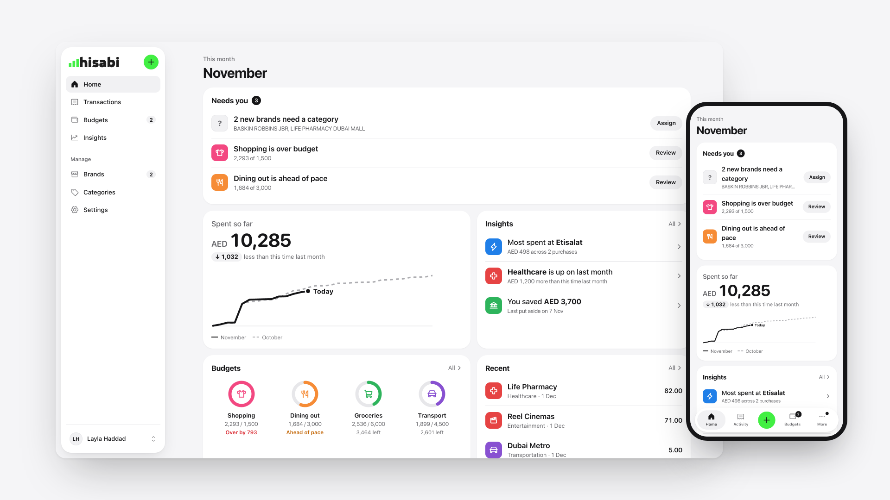

<h1 align="center">
    
</h1>

<p align="center">
  <b>Hisabi is a self-hosted personal finance app that turns your bank SMS into a calm, clear picture of your money: what needs you, how the month is going, and where it all went.</b>
</p>

<p align="center"></p>


## 🛠 Features

- [x] 📩 **Paste a bank SMS:** Hisabi picks out the amount, the card and the shop, and remembers each shop's category for next time
- [x] 🔄 **SMS sync from your Mac:** if your iPhone's messages reach your Mac, a small background tool sends new bank SMS as they arrive, without ever adding one twice ([tools/mac-sms-sync](tools/mac-sms-sync))
- [x] ✅ **Needs you:** new brands to categorize, budgets over or ahead of pace, and messages it couldn't read, at the top of the home, with actions right there
- [x] 📈 **This month at a glance:** what you've spent so far against the same point last month, plus a few insights written as plain sentences
- [x] 🎯 **Budgets:** monthly, weekly, yearly or custom, shown as rings, with history to compare periods
- [x] 📊 **Insights:** net worth, where your income went, spending by category, by month and by brand, with the detailed charts one tap away
- [x] 📺 **Kitchen display:** a full-screen view for a tablet on the wall that goes dark at night
- [x] 📱 **Phone friendly:** a bottom dock on phones, a floating sidebar on laptops
- [x] 🔐 **Self-hosted:** your data stays on your own server
- [x] 🆓 **MIT licensed:** fully open source
- [ ] Exporting your data (coming soon)
- [ ] Multiple accounts (coming soon)
- [ ] API support (coming soon)

New to Hisabi? The home starts with just the SMS box and fills in as your transactions come in, so you never stare at empty charts.

## ▶️ Installation

On a fresh Ubuntu 22.04+ or Debian 12+ server, with a domain pointing at it:

```bash
curl -fsSL https://raw.githubusercontent.com/hisabi-app/hisabi/main/install.sh -o install.sh
sudo bash install.sh --domain hisabi.example.com
```

The script installs PHP 8.4, MySQL (MariaDB on Debian), Node and [Caddy](https://caddyserver.com), builds Hisabi in `/var/www/hisabi` and gets an HTTPS certificate for the domain. At the end it asks for your name, email and password. Without `--domain`, Hisabi is served over plain http on port 80.

### Upgrading

Run the script again with `sudo bash install.sh`. It pulls the latest code, rebuilds and runs the migrations, and keeps your `.env` and database.

### Moving from the Docker install

Export the database on the old machine, then install with it:

```bash
docker-compose exec -T mysql mysqldump -uroot -proot hisabi > hisabi.sql   # on the old machine
sudo bash install.sh --domain hisabi.example.com --import hisabi.sql       # on the new server
```

## 💬 Your bank's SMS

Hisabi reads SMS using the templates in `config/hisabi.php` (`sms_templates`), with placeholders such as `{amount}`, `{brand}`, `{card}`, `{date}`, `{time}` and `{ignore}`. If your bank's messages aren't picked up, add a template that matches them. A template can span several lines (`\n`) for banks that send multi-line messages. The currency is set in the same file.

Messages Hisabi couldn't read show up under **Needs you**, so you can fix or delete them.

To have new bank SMS arrive by themselves, see [tools/mac-sms-sync](tools/mac-sms-sync): it reads them from Messages on a Mac and sends them to `POST /api/v1/sms/sync` with a token from `php artisan hisabi:sms-sync-token`. A message that was already synced or pasted is never added again.

## 📺 Kitchen display

`/kiosk` is a full-screen dashboard for a tablet on the wall: what you've spent this month compared with the same time last month, what's left in each budget, and the latest transaction. It's white by day and switches to a dark version from 10pm to 6am. It refreshes itself every hour and reloads once a day at 4am.

1. Keep the tablet logged in by setting `SESSION_LIFETIME=525600` (a year, in minutes) in `.env`, then run `php artisan config:clear`.
2. On the tablet, install a kiosk browser such as [Fully Kiosk Browser](https://www.fully-kiosk.com), set its start URL to `http://<your-hisabi>/kiosk`, turn on *Keep Screen On* and *Launch on Boot*, and log in once.

## 🧑‍💻 Contributing

Hisabi is Laravel 12 with React, Inertia and Tailwind.

```bash
composer install && npm install
composer dev        # server, queue, logs and Vite together
php artisan test    # PHP tests
npm run test        # frontend tests
```

Before changing the UI, read [`PRODUCT.md`](PRODUCT.md) (who Hisabi is for and how it should feel) and [`DESIGN.md`](DESIGN.md) (colors, type, components and motion). [`AGENT.md`](AGENT.md) explains how the code is laid out.

## 🔖 License

This project is licensed under the MIT License - see the [LICENSE.md](https://github.com/hisabi-app/hisabi/blob/main/LICENSE) file for details.
