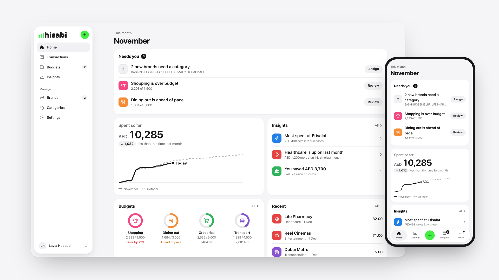

<h1 align="center">
    
</h1>

<p align="center">
  <b>Hisabi is a simple yet powerful, self-hosted personal finance tracking web app with the ability to parse SMS transactions, and generate very useful insights about your money!</b>
</p>

<p align="center"><a href="https://www.youtube.com/watch?v=kfwcMdlFn9o&list=PLw5MK6ws-o1_rNobmZCmnH5G11vwCiKKk&ab_channel=ILoveMathAcademy" target="__blank"></a></p>


## 🛠 Features

- [x] 🔐 Self-hosted — Full control over your data
- [x] 📩 SMS Parser — Auto-detect bank transactions
- [x] 📊 Reports & Visualization — Clear finance insights
- [ ] Multiple Accounts (Coming Soon)
- [ ] API Support (Coming Soon)
- [x] 🆓 MIT Licensed — Fully open-source


## 🎮 Demo

Try the app with [live demo](https://hisabi.on-forge.com/).

## ▶️ Installation 

> Docker Installation
   
```bash
git clone https://github.com/hisabi-app/hisabi && cd hisabi

make build # build the docker image
make run # the same as docker-compose up -d

# wait for a few seconds to allow the DB to finish the setup then run
make install # only for the first time
```

Once done, visit the app on `http://localhost`

## 📺 Kitchen display

`/kiosk` is a full-screen dashboard for a tablet on the wall: what you've spent this month compared with the same time last month, and what's left in each budget. It refreshes itself every hour and reloads once a day at 4am.

1. Keep the tablet logged in by setting `SESSION_LIFETIME=525600` (a year, in minutes) in `.env`, then run `php artisan config:clear`.
2. On the tablet, install a kiosk browser such as [Fully Kiosk Browser](https://www.fully-kiosk.com), set its start URL to `http://<your-hisabi>/kiosk`, turn on *Keep Screen On* and *Launch on Boot*, and log in once.

## 🔖 License

This project is licensed under the MIT License - see the [LICENSE.md](https://github.com/hisabi-app/hisabi/blob/main/LICENSE) file for details.
